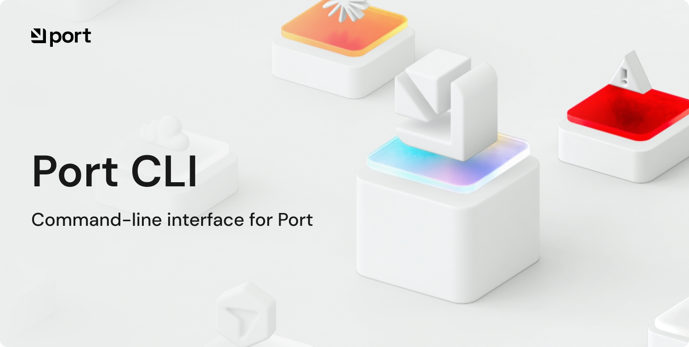
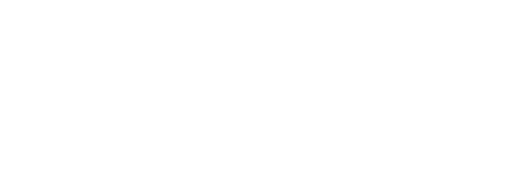

# Port CLI



<br />

A modular command-line interface for Port that enables authentication, API operations, data import/export, organization migration — using a pluggable module architecture.

## Features

- **Authenticate**: log in to multiple organizations simultaneously
- **API Operations**: Direct CRUD operations on Port resources
- **Import**: Restore data from backups
- **Export**: Backup Port data (blueprints, entities, scorecards, actions, teams, automations, pages, integrations)
- **Migrate**: Transfer data between Port organizations
- **Compare**: Diff two Port organizations and generate reports (text, JSON, HTML)
- **Clear**: Bulk-delete org resources (blueprints, entities, actions, scorecards, automations, pages)
- **Skills**: Sync AI skills from Port into your local AI coding tools (Cursor, Claude Code, Gemini CLI, OpenAI Codex, Windsurf, GitHub Copilot)

For full documentation, see the [Port CLI docs](https://docs.port.io/context-lake/consuming-the-lake/port-cli/overview):

- [Installation and configuration](https://docs.port.io/context-lake/consuming-the-lake/port-cli/installation)
- [Examples](https://docs.port.io/context-lake/consuming-the-lake/port-cli/examples)

### AI Skill Hooks

> [!WARNING]  
> This functionality is planned to be deprecated in the future. If you're using
> it, you can keep doing so, but note that we will introduce a new way of working with skills.

Automatically sync skills from your Port organization into local AI coding tools (Cursor, Claude Code, Gemini CLI, OpenAI Codex, Windsurf, GitHub Copilot).
Synced and uploaded skills follow the [Agent Skills specification](https://agentskills.io/specification): a skill directory with `SKILL.md` at the root, plus optional `scripts/`, `references/`, and `assets/`.
The default skills model supports sync/list/search. Upload and publish commands require the labs versioned skills data model; contact Port to enable it.

```bash
# One-time setup: choose tools and skill selection (saved to ~/.port/config.yaml)
port skills init

# Download skills to disk (after init, or pass --tool for a one-off sync)
port skills sync
port skills sync --tool Cursor --group operations
port skills sync --tool Cursor --tool "Claude Code" --tool Windsurf

# Scripts/CI: explicit flags or -y to select every option without prompts
port skills init -y
port skills init --tool Cursor --select-all-groups --select-all-ungrouped
port skills add --group my-group --skill my-skill --tool Cursor
port skills add integrations-overview
port skills add -y
port skills remove integrations-overview
port skills remove --tool Windsurf

# Check what's configured
port skills status

# Delete locally synced skill files only (hooks remain; skills re-sync on next session)
port skills clear

# Full cleanup: remove hooks, skill files, and config — everything Port CLI installed
port cache clear
```

See [docs/skills-setup.md](docs/skills-setup.md) for full setup instructions, including the [main skills data model](docs/skills-main-data-model.md) and [labs versioned skills data model](docs/skills-versioned-data-model.md).

## Contributing

See [CONTRIBUTING.md](CONTRIBUTING.md) for development guidelines.

## Release Process

See [RELEASE.md](RELEASE.md) for release procedures.

## License

MIT License - see [LICENSE](LICENSE)

## References

- [Port Documentation](https://docs.getport.io)
- [Port API Reference](https://docs.getport.io/api-reference/port-api)

---

<picture>
  <source media="(prefers-color-scheme: dark)"
  srcset="./docs/Port_logo_black.svg">
  
</picture>
